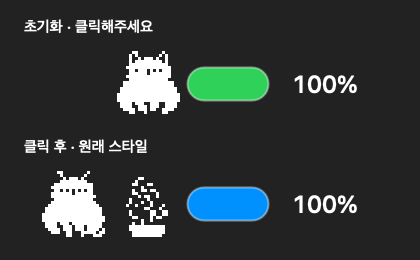
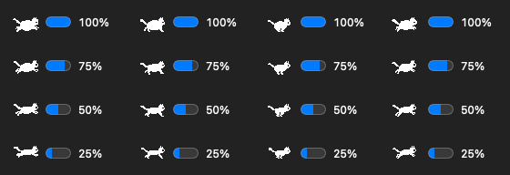

## v0.4.3 — 클로드 한도를 더 정확하게 보여요 🐈

- Claude 조회에 실패하면 오래된 한도와 초기화 시각을 숨기고 오류를 알려줘요.
- Claude를 선택 중일 때 조회가 실패하면 메뉴 막대에 확인 불가 상태를 표시해요. 로그인을 갱신하고 조회에 성공하면 기존 선택이 돌아와요.
- Codex 연결 상태와 갱신 시각에 서비스 이름을 표시해요.

[v0.4.3 릴리즈 노트](docs/release-notes/v0.4.3.md) · [전체 업데이트 내역](CHANGELOG.md)

---

## v0.4.2 — 더 작고 깔끔하게 보여요 🐈

- 남은 한도 숫자와 중복 정보를 줄여 패널을 더 간결하게 정리했어요.
- 토큰 사용량은 **누적·최근 일별 한 줄 요약**으로 보여요. 숫자에 마우스를 올리면 정확한 토큰 수를 볼 수 있어요.
- 패널 높이를 **480pt**로 줄였어요. 제목과 하단 버튼을 고정하고, 공간이 부족하면 가운데 내용만 스크롤돼요.
- 프로필과 Codex·Claude 한도 목록, 메뉴 막대에 표시할 한도 선택은 그대로 사용할 수 있어요.

[v0.4.2 릴리즈 노트](docs/release-notes/v0.4.2.md) · [전체 업데이트 내역](CHANGELOG.md)

---

## v0.4.1 — 패널 잘림 고쳤어요 🐈

- 한도 줄이 늘어나도 **새로고침·설정·종료** 버튼이 화면 밖으로 밀리지 않아요. 공간이 모자라면 가운데만 스크롤돼요.

[v0.4.1 릴리즈 노트](docs/release-notes/v0.4.1.md)

---

## v0.4.0 — 코덱스와 클로드 한도를 한눈에 🐾

- 남은 한도 카드 아래에 **한도별 게이지** 목록이 생겼어요. 한도마다 남은 %, 진행 막대, 초기화 시각이 보여요.
- **Claude 한도**도 함께 보여요. 5시간·주간 한도, 계정에 따라 Opus·Sonnet 주간 한도까지 나와요.
- 목록에서 **체크한 한도**가 메뉴 막대 게이지로 표시돼요.
- 패널 상단에 **앱 버전**이 보여요.

Claude 한도는 이 맥의 Claude Code 로그인 정보를 사용해요. 처음 실행할 때 키체인 창이 뜨면 **항상 허용**을 눌러 주세요. 터미널에서 `claude`로 구독 계정에 로그인되어 있어야 해요.

[v0.4.0 릴리즈 노트](docs/release-notes/v0.4.0.md)

---

## v0.3.0 — 한도가 차면 고양이가 게이지를 툭툭 쳐요 🐾

한도가 초기화되면 고양이가 먼저 알려줘요.
호기심이 생긴 고양이가 초록색 게이지를 툭툭 건드리고, 게이지도 발에 맞춰 살짝 움찔해요.



- 사용 중이던 한도가 초기화되어 **남은 한도가 100%**가 되면 시작해요.
- 메뉴바 고양이를 **클릭**하면 평소 고양이·밥그릇과 **파란색 게이지**로 돌아와요.
- 남은 한도가 **100% 미만**이 되어도 자동으로 돌아와요.
- 창이 이미 열려 있다면 **“눌러서 진정시키기”** 버튼을 눌러도 돼요.
- 한도가 부족할 때의 주황색·빨간색 경고는 그대로예요.
- 처음 앱을 켰을 때 보이는 100%는 초기화로 오인하지 않아요. 실행 중 새로 조회한 한도 변화를 기준으로 작동해요.

기존 **초당 5프레임과 이미지 캐시**를 사용해요. 축하 애니메이션이나 클릭으로 사용량을 추가 조회하지 않아요.
화면 꺼짐·절전 모드·동작 줄이기 설정도 그대로 따라요.

기능 테스트 **70개를 통과**했어요. 개발 맥의 가상 데이터 미리보기에서 30초간 측정한 CPU는 평균 **약 1.6%**, 최고 **약 2.6%**였어요. 환경에 따라 달라질 수 있어요.

[v0.3.0 릴리즈 노트](docs/release-notes/v0.3.0.md)

---

## v0.2.1 개선했어요 🐈

- CPU 코어 하나를 계속 쓰던 현상 잡았어요. **약 99.8% → 4.0%**
- 메모리 부담도 줄였어요. **약 248MB → 47MB**
- 사용량 조회할 때 서버를 두 번 켜던 걸 한 번으로 줄였어요.
- 화면이 꺼지거나 세션이 비활성화되면 애니메이션과 자동 조회도 쉬어요.
- 절전 모드와 동작 줄이기에서는 고양이도 쉬어요.
- 고양이 **32프레임은 그대로**예요.

수치는 개발 맥에서 측정했어요. 개선 후 10분 동안 CPU 평균은 약 4.0%, 마지막 메모리 부담(physical footprint)은 약 47MB였어요. 환경에 따라 달라질 수 있어요.

---

# Codex Gauge

# 토큰 남은 사용량 보여주어요

[](https://git.io/typing-svg)



# 맥 전용이고 M1 이상만 되어요

[](https://git.io/typing-svg)


# 인증되지 않은 앱 이어요


# 설치는 이렇게 하셔요

기존 버전을 쓰고 있다면 앱을 먼저 종료한 뒤 새 앱으로 교체해 주세요.

1. [Releases](https://github.com/RabbitTasteDog-PRO/codex_gauge/releases)에서 앱 ZIP을 받아요.
2. 압축 풀고 `Codex Gauge.app`을 응용 프로그램 폴더에 넣어요.
3. Codex CLI가 없으면 터미널에서 이거 한 번 실행해요. [공식 설치 안내](https://learn.chatgpt.com/docs/codex/cli)

    ```sh
    curl -fsSL https://chatgpt.com/codex/install.sh | sh
    ```

4. 앱 더블 클릭하고 브라우저에서 내 ChatGPT 계정으로 로그인해요. 
5. 위에 고양이 뜨면 된 거예요.

실행이 막히면 출처를 확인하고 **시스템 설정 → 개인정보 보호 및 보안 → 그래도 열기**로 열어요.

[](https://git.io/typing-svg)


# 문제가 생겼기면 
[](https://git.io/typing-svg)

# 안받으면 되어요

# 마음껏 수정하세요 

## 릴리즈 파일과 업로드

앱 ZIP과 체크섬 파일 생성:

```sh
bash scripts/package-release.sh
```

--- 
생성 결과는 `dist/releases/v버전/`에 저장됩니다. [GitHub 릴리즈 업로드 안내](docs/RELEASING.md)에 첫 커밋·푸시부터 태그 생성, 파일 첨부와 게시 순서를 정리했습니다.


공식 인터페이스: [Codex App Server](https://learn.chatgpt.com/docs/app-server), [Apple NSStatusItem](https://developer.apple.com/documentation/appkit/nsstatusitem).
